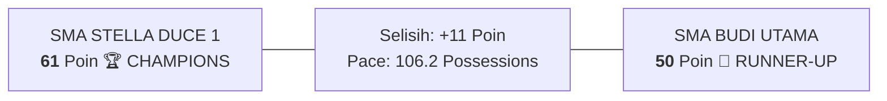

# Analisis Statistik Hasil Laga Final Putri
## Honda DBL with Kopi Good Day D.I. Jogjakarta Series 2026

* **Kompetisi:** DBL D.I. Jogjakarta Series (Women / Putri)  
* **ID Kompetisi Sumber:** `49609`  
* **Game ID:** `2938167`  
* **Jadwal Pertandingan:** 10 Oktober 2026, 14:40 WIB  
* **Hasil Akhir:** **SMA STELLA DUCE 1 YOGYAKARTA (61) vs SMA BUDI UTAMA (50)**  
* **Gelar Juara:** **SMA Stella Duce 1 Yogyakarta Resmi Menjadi Juara (Champions)**  

---

## 1. Ringkasan Hasil & Papan Skor

| Tim Finalis | Skor Akhir | Status | FG (Akurasi) | 2P (Akurasi) | 3P (Akurasi) | FT (Akurasi) | Rebound (O/D) | TOV | STL | Poin di Paint |
| :--- | :---: | :---: | :---: | :---: | :---: | :---: | :---: | :---: | :---: | :---: |
| 🥇 **SMA Stella Duce 1 (STECE)** | **61** | **CHAMPIONS** | 28/83 (33.7%) | 28/75 (37.3%) | 0/8 (0.0%) | 5/23 (21.7%) | **52 (26/20)** | 42 | **39** | **54 Poin** |
| 🥈 **SMA Budi Utama (Putri)** | **50** | **RUNNER-UP** | 16/43 (37.2%) | 13/31 (41.9%) | **3/12 (25.0%)**| **15/31 (48.4%)**| 42 (7/31) | **58** | 26 | 26 Poin |

---

## 2. Perbandingan Statistik Kolektif Tim (Team Comparison)

| Parameter Statistik | SMA Stella Duce 1 (STECE) | SMA Budi Utama | Margin & Evaluasi Taktis |
| :--- | :---: | :---: | :--- |
| **Skor Akhir (PTS)** | **61** | **50** | **+11 untuk STECE** |
| **Field Goal Attempts (FGA)** | **83 Percobaan** | 43 Percobaan | 🔑 **Stece melepaskan +40 tembakan lebih banyak** |
| **Field Goals Made (FGM)** | **28 Masuk (33.7%)** | 16 Masuk (37.2%) | Stece unggul volume, Budi Utama unggul persentase |
| **2-Pointers (2PM/2PA)** | **28 / 75 (37.3%)** | 13 / 31 (41.9%) | Stece mendominasi tusukan ke ring |
| **3-Pointers (3PM/3PA)** | 0 / 8 (0.0%) | **3 / 12 (25.0%)** | Budi Utama unggul 3 tripoin (+9 poin) |
| **Free Throws (FTM/FTA)** | 5 / 23 (21.7%) | **15 / 31 (48.4%)** | Budi Utama unggul +10 poin dari garis FT |
| **Offensive Rebounds** | **26 OREB** | 7 OREB | 🔑 **Stece dominan +19 second chance possessions** |
| **Defensive Rebounds** | 20 DREB | **31 DREB** | Budi Utama mengamankan defensive glass |
| **Total Rebounds** | **52 Rebound** | 42 Rebound | Stece +10 total rebound |
| **Assists (AST)** | **19** | 14 | Aliran bola Stece lebih dinamis |
| **Turnovers (TO)** | **42** | **58** | 🔑 **FAKTOR PENENTU #1: Budi Utama 58 Turnover** |
| **Steals (STL)** | **39** | 26 | **Total 65 Steals** di laga final (*Chaos Pace*) |
| **Blocks (BLK)** | 1 | **6** | Budi Utama unggul rim protection (Naysia 3 BLK) |
| **Points in the Paint (PIP)**| **54 Poin** | 26 Poin | 🔑 **Stece unggul telak +28 poin di dalam paint** |
| **Points off Turnovers (PFT)**| **36 Poin** | 34 Poin | Kedua tim sama-sama menghukum turnover lawan |
| **Fastbreak Points (FBP)** | **25 Poin** | 20 Poin | Serangan balik kilat Stece (+5) |
| **Second Chance Points (2CP)**| **10 Poin** | 6 Poin | Stece +4 |
| **Biggest Lead (BL)** | **21 Poin** | 0 Poin | Stece memimpin laga sejak kuarter pembuka |
| **Total Penguasaan (Pace)** | **106.2 Possessions** | **106.2 Possessions** | Tempo sangat cepat dengan turnover tinggi |

---

## 3. Analisis Four Factors Laga Final Putri (Dean Oliver)

```mermaid
xychart-beta
    title "Perbandingan Four Factors Final Putri (STECE vs Budi Utama)"
    x-axis ["eFG% (Shooting)", "TOV% (Turnover)", "ORB% (Off. Reb)", "FT Rate (FTA/FGA)"]
    y-axis "Persentase (%)" 0 --> 80
    bar [33.73, 31.08, 45.61, 27.71]
    bar [40.70, 50.59, 25.93, 72.09]
```

| Four Factors (Bobot) | SMA Stella Duce 1 (STECE) | SMA Budi Utama | Analisis Keunggulan Laga Final |
| :--- | :---: | :---: | :--- |
| **1. Shooting (eFG%) – 40%** | 33.73% | **40.70%** | **Budi Utama Unggul (+6.97%)**: Berkat 3 tripoin Naysia Santosa, Budi Utama lebih efisien per tembakan. |
| **2. Turnovers (TOV%) – 25%** | **31.08%** *(Lebih Baik)*| **50.59%** | 🔑 **STECE UNGGUL MUTLAK (+19.51% Margin)**: Budi Utama kehilangan bola pada 50.6% total penguasaan akibat 39 steal Stece. |
| **3. Rebounding (ORB%) – 20%**| **45.61%** | 25.93% | 🔑 **STECE UNGGUL MUTLAK (+19.68% Margin)**: Stece merebut 26 offensive rebound dari 57 tembakan meleset. |
| **4. Free Throw Rate – 15%** | 27.71% (23 FTA) | **72.09% (31 FTA)** | **Budi Utama Unggul (+44.38%)**: Agresivitas memancing pelanggaran menghasilkan 31 tembakan FT untuk Budi Utama. |

* **Skor Ofensif Final (0–100):** STECE **43.98** vs Budi Utama **38.56**
* **Skor Defensif Final (0–100):** STECE **61.44** vs Budi Utama **56.02**
* **Overall Rating Final:** STECE **52.71** vs Budi Utama **47.29**
* **Net Margin Laga Final:** **+5.42 untuk SMA Stella Duce 1**

---

## 4. Statistik Lengkap Individu Pemain

### A. 🥇 SMA Stella Duce 1 Yogyakarta (CHAMPIONS)

| No | Nama Pemain | MIN | PTS | FG | 2P | 3P | FT | REB (O/D) | AST | TO | STL | BLK | PF | EFF |
| :---: | :--- | :---: | :---: | :---: | :---: | :---: | :---: | :---: | :---: | :---: | :---: | :---: | :---: | :---: |
| **#8** | **Alicia Graceitha Putri** | 35:57 | **14** | 7/15 | 7/14 | 0/1 | 0/5 | 8 (3/5) | 1 | 5 | **9** | 0 | 4 | **14.0** |
| **#13** | **Naima Syafira Hanif** | 31:07 | **18** | 8/20 | 8/18 | 0/2 | 2/4 | 8 (4/4) | 4 | 11 | 5 | 0 | 3 | **10.0** |
| **#15** | **Nathanela Nirwasita** | 27:37 | **10** | 4/16 | 4/15 | 0/1 | 2/8 | **11 (7/4)**| 3 | 6 | 5 | 0 | 5 | **5.0** |
| **#5** | **Shalomita Abila Yoel** | 36:49 | **8** | 4/13 | 4/10 | 0/3 | 0/4 | 5 (3/2) | 2 | 2 | 2 | 0 | 3 | **2.0** |
| **#9** | **Alicia Lie Putri Prabowo**| 19:28 | **7** | 3/8 | 3/8 | 0/0 | 1/2 | 2 (0/2) | 1 | 3 | **8** | 1 | 1 | **10.0** |
| **#4** | **Maria Theresia Oktavie** | 23:00 | **2** | 1/7 | 1/6 | 0/1 | 0/0 | 3 (1/2) | **5** | 5 | **8** | 0 | 3 | **7.0** |
| **#14** | **Elisabeth Aurea Putri** | 6:10 | **2** | 1/1 | 1/1 | 0/0 | 0/0 | 2 (1/1) | 0 | 2 | 0 | 0 | 2 | **2.0** |
| **#10** | **Vincentia Saraswati** | 15:37 | **0** | 0/3 | 0/3 | 0/0 | 0/0 | 7 (7/0) | 3 | 2 | 2 | 0 | 2 | **7.0** |
| **#11** | **Angelica Joysianne H.** | 1:03 | **0** | 0/0 | 0/0 | 0/0 | 0/0 | 0 (0/0) | 0 | 0 | 0 | 0 | 0 | **0.0** |
| **#6** | **Crysant Bethany E. H.** | 1:03 | **0** | 0/0 | 0/0 | 0/0 | 0/0 | 0 (0/0) | 0 | 2 | 0 | 0 | 0 | **-2.0** |
| **#7** | **Josephine Carla Ryangel**| 1:03 | **0** | 0/0 | 0/0 | 0/0 | 0/0 | 0 (0/0) | 0 | 0 | 0 | 0 | 0 | **0.0** |
| **#12** | **Natasya Gracia** | 1:03 | **0** | 0/0 | 0/0 | 0/0 | 0/0 | 0 (0/0) | 0 | 0 | 0 | 0 | 0 | **0.0** |
| **TOTAL**| **SMA STELLA DUCE 1** | - | **61** | **28/83** | **28/75**| **0/8**| **5/23**| **52 (26/20)**| **19**| **42**| **39**| **1** | **23**| **57.0** |

---

### B. 🥈 SMA Budi Utama (RUNNER-UP)

| No | Nama Pemain | MIN | PTS | FG | 2P | 3P | FT | REB (O/D) | AST | TO | STL | BLK | PF | EFF |
| :---: | :--- | :---: | :---: | :---: | :---: | :---: | :---: | :---: | :---: | :---: | :---: | :---: | :---: | :---: |
| **#4** | **Naysia Agustina Santosa** | 29:10 | **19** | 7/14 | 4/8 | **3/6** | 2/5 | 3 (1/2) | 3 | 8 | 3 | **3** | 2 | **13.0** |
| **#6** | **Zahira Adiya Mecca** | 28:18 | **12** | 3/7 | 3/6 | 0/1 | 6/12| 8 (2/6) | 0 | 8 | 3 | 0 | 4 | **5.0** |
| **#10** | **Nicolle Jacqueline I. S.**| 30:13 | **5** | 1/4 | 1/3 | 0/1 | 3/5 | 5 (0/5) | 1 | 5 | 2 | 0 | 3 | **3.0** |
| **#5** | **Hanani Sanjaya** | 14:09 | **4** | 1/1 | 1/1 | 0/0 | 2/4 | 5 (0/5) | 2 | 3 | 4 | 0 | 3 | **10.0** |
| **#12** | **Difa Amelia Dianur** | 24:28 | **3** | 1/9 | 1/5 | 0/4 | 1/4 | 6 (2/4) | **4** | 6 | **6** | 0 | 2 | **2.0** |
| **#11** | **Feodora Poetri Permana** | 8:03 | **3** | 1/1 | 1/1 | 0/0 | 1/1 | 3 (1/2) | 1 | 4 | 1 | 0 | 0 | **4.0** |
| **#7** | **Gracielle Alayna Ong** | 22:25 | **2** | 1/4 | 1/4 | 0/0 | 0/0 | 1 (0/1) | 1 | 8 | 2 | 0 | 1 | **-5.0** |
| **#8** | **Queenara Alfarzana P.** | 17:43 | **2** | 1/1 | 1/1 | 0/0 | 0/0 | 3 (0/3) | 2 | 8 | 2 | 0 | 5 | **1.0** |
| **#15** | **Maycha Kayla Nindiyani** | 17:13 | **0** | 0/1 | 0/1 | 0/0 | 0/0 | 4 (1/3) | 0 | 3 | 1 | **3** | 1 | **4.0** |
| **#13** | **Benedicta Elvina M.** | 4:12 | **0** | 0/1 | 0/1 | 0/0 | 0/0 | 0 (0/0) | 0 | 0 | 1 | 0 | 1 | **0.0** |
| **#9** | **Catherine Olivia Handoyo**| 1:48 | **0** | 0/0 | 0/0 | 0/0 | 0/0 | 0 (0/0) | 0 | 0 | 1 | 0 | 0 | **1.0** |
| **#14** | **Gabrielle Seanna** | 2:15 | **0** | 0/0 | 0/0 | 0/0 | 0/0 | 0 (0/0) | 0 | 1 | 0 | 0 | 0 | **-1.0** |
| **TOTAL**| **SMA BUDI UTAMA** | - | **50** | **16/43** | **13/31**| **3/12**| **15/31**| **42 (7/31)**| **14**| **58**| **26**| **6** | **20**| **37.0** |

---

## 5. Sorotan Profil & Peran Pemain Kunci

### 🌟 Bintang Juara SMA Stella Duce 1
1. **Alicia Graceitha Putri (#8) – *Final MVP & Defensive Anchor***
   * Bermain 35 menit 57 detik, mencetak **14 Poin** (50% 2PT), 8 Rebound, dan rekor luar biasa **9 Steals!** Memimpin perolehan efisiensi tim (14.0).
2. **Naima Syafira Hanif (#13) – *Top Scorer Stece***
   * Top scorer tim dengan **18 Poin** lewat 8 tusukan ke dalam *paint area*, ditambah 8 Rebound, 4 Assist, dan 5 Steals.
3. **Nathanela Nirwasita (#15) – *Double-Double Under the Rim***
   * Mengamankan **10 Poin** dan **11 Rebound** (7 di antaranya adalah *offensive rebound*), memberikan *possession* ekstra vital bagi Stece.
4. **Trio Perimeter Disruptors (Alicia Graceitha, Alicia Lie, Maria Theresia)**
   * Ketiga pemain ini mengumpulkan total **25 Steals** (9 + 8 + 8), menjadi aktor utama yang memporak-porandakan skema serangan Budi Utama.

### 🌟 Bintang Pejuang SMA Budi Utama
1. **Naysia Agustina Santosa (#4) – *Top Scorer Laga Final***
   * Tampil fenomenal dengan torehan **19 Poin** (termasuk 3 tembakan 3-poin dengan akurasi 50%), 3 Rebound, 3 Assist, 3 Steal, dan **3 Blocks**.
2. **Zahira Adiya Mecca (#6) – *Inside Scorer***
   * Menyumbang **12 Poin**, 8 Rebound, 3 Steal, dan memancing 8 kali pelanggaran lawan (6/12 FT).
3. **Difa Amelia Dianur (#12) – *Playmaker & Hustle Player***
   * Mencatat **6 Steals**, 6 Rebound, dan 4 Assists dalam 24 menit laga.

---

## 6. Faktor Kunci & Kesimpulan Taktis

### 1. Perbedaan Volume Percobaan Tembakan (+40 FGA untuk Stece)
Meskipun akurasi tembakan Budi Utama lebih unggul (37.2% vs 33.7%), Stece berhasil melepaskan **83 tembakan** berbanding hanya **43 tembakan** dari Budi Utama. Keunggulan volume +40 tembakan ini didapat langsung dari **39 steal** dan **26 offensive rebound**.

### 2. Pesta Poin di Area Paint (Points in Paint: 54 vs 26)
Tanpa mencetak satu pun tembakan 3-poin (0/8 3PT), Stella Duce 1 fokus 100% mengeksekusi serangan di bawah ring. Dari total 61 poin Stece, sebanyak **54 poin dicetak di dalam *paint area*** melalui tusukan tajam Naima Hanif dan Alicia Graceitha.

### 3. Tekanan Full-Court Trap Menghasilkan 58 Turnover Lawan
Tingkat turnover Budi Utama mencapai **50.59%** (kehilangan bola pada separuh total *possession*). Pressing tanpa henti dari guard Stece memutus jalur distribusi bola Budi Utama sejak *inbound pass*, mengunci keunggulan Stece hingga buzzer akhir berbunyi.
