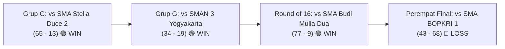

# Analisis Statistik Tim Basket Putra SMA Budi Utama
**Kompetisi:** Honda DBL with Kopi Good Day D.I. Jogjakarta Series (Men/Putra)  
**ID Kompetisi Sumber:** `49607`  
**ID Tim Sumber:** `146119`  
**Status / Capaian:** Juara Grup G (2-0) & Perempat Finalis (*Big Eight*)  
**Rekor Keseluruhan:** 3 Menang – 1 Kalah (3-1)  
**Peringkat Four Factors:** **Peringkat #4 dari 27 Tim** (Net Margin: **+9.99**)

---

## 1. Ringkasan Rekor & Hasil Pertandingan

### Rincian Laga per Laga

| No | Tanggal | Babak / Fase | Lawan | Skor | Status | 2CP (BU vs Lawan) | Highlight Utama |
| :---: | :---: | :--- | :--- | :---: | :---: | :---: | :--- |
| **1** | 28 Sep 2026 | Penyisihan Grup G | SMA Stella Duce 2 | **65 – 13** | **WIN** | 17 vs 0 | 22 Steals, 17 Offensive Rebounds, Kenzo 17 Pts |
| **2** | 02 Okt 2026 | Penyisihan Grup G | SMAN 3 Yogyakarta | **34 – 19** | **WIN** | 17 vs 5 | 23 Steals, 20 Offensive Rebounds, Mohsin 11 Reb |
| **3** | 05 Okt 2026 | Playoffs (*Round of 16*) | SMA Budi Mulia Dua | **77 – 9** | **WIN** | 14 vs 0 | 37 Steals, 24 Assists, Kenzo 16 Pts (8/9 FG) |
| **4** | 07 Okt 2026 | Perempat Final (*Big Eight*) | SMA BOPKRI 1 (BOSA) | **43 – 68** | **LOSS** | 4 vs 23 | Kalah Rebound (39 vs 65) melawan sang juara bertahan |

---

## 2. Analisis Four Factors (Dean Oliver)

Metrik Four Factors membedah efisiensi per *possession* tim dengan 4 indikator utama penentu kemenangan:

### A. Four Factors Akumulasi Turnamen vs Seluruh Kompetisi

| Four Factors | Nilai Budi Utama | Peringkat di DBL Jogja (27 Tim) | Nilai Lawan (Defense) | Keterangan / Analisis Taktis |
| :--- | :---: | :---: | :---: | :--- |
| **1. Shooting (eFG%) – Bobot 40%** | **38.20%** | **#5** | **29.55%** | Unggul +8.65% atas lawan; serangan sangat bergantung pada finishing area *paint*. |
| **2. Turnovers (TOV%) – Bobot 25%** | **16.43%** | **#3** | **42.60%** *(Rank #3)* | **Keunggulan terbesar**: Proteksi bola sendiri rapi (16.4%) dan memaksa lawan turnover 42.6%. |
| **3. Rebounding (ORB% / DRB%) – Bobot 20%** | **43.14%** (ORB) | **#8** | **61.90%** (DRB) | *Offensive rebound* sangat tinggi di 3 laga awal, namun tertekan di laga perempat final. |
| **4. Free Throw Rate (FTR) – Bobot 15%** | **22.40%** | **#15** | **29.22%** | Lawan lebih banyak mendapatkan FT attempt per FGA dibandingkan Budi Utama. |

* **Skor Ofensif (0–100):** **48.16** *(Peringkat 4)*
* **Skor Defensif (0–100):** **61.83** *(Peringkat 7)*
* **Overall Composite Rating:** **54.99** *(Peringkat 4)*
* **Net Margin Rating:** **+9.99** *(Peringkat #4 dari 27 Tim SMA Putra)*

---

### B. Matriks Four Factors Laga per Laga (*Game-by-Game Breakdown*)

| Pertandingan | eFG% (BU vs Lawan) | TOV% (BU vs Lawan) | ORB% (BU) | DRB% (BU) | FT Rate (BU vs Lawan) | Net Game Rating |
| :--- | :---: | :---: | :---: | :---: | :---: | :---: |
| **vs SMA Stella Duce 2 (65–13)** | **49.17%** vs 19.70% | **13.44%** vs 47.62% | **58.62%** | 56.00% | 16.67% vs 15.15% | **+23.40** (Dominasi Mutlak) |
| **vs SMAN 3 Yogyakarta (34–19)** | **25.00%** vs 24.00% | **16.69%** vs 48.50% | **46.51%** | 54.55% | 34.62% vs 72.00% | **+9.82** (Defensif Mengunci) |
| **vs SMA Budi Mulia Dua (77–9)** | **50.00%** vs 15.38% | **12.51%** vs 60.21% | **56.76%** | 73.91% | 12.33% vs 15.38% | **+31.25** (Performa Terbaik) |
| **vs SMA BOPKRI 1 (43–68)** | **25.38%** vs 40.00% | **22.26%** vs 22.76% | **17.39%** | 51.16% | 29.23% vs 37.14% | **-13.20** (Kalah Size & Rebound) |

---

## 3. Statistik Kolektif Tim (Traditional Stats)

| Parameter | Total (4 Laga) | Rata-rata per Laga | Efisiensi / Persentase |
| :--- | :---: | :---: | :--- |
| **Poin Dicetak (PTS)** | 219 | **54.8** PPG | Margin skor rata-rata: **+27.5** |
| **Poin Kebobolan (PA)** | 109 | **27.3** PPG | Pertahanan kebobolan rata-rata < 30 poin |
| **Field Goals (FG)** | 89 / 250 | **22.3 / 62.5** | **35.6%** |
| **2-Point Field Goals** | 76 / 174 | **19.0 / 43.5** | **43.7%** (Fokus utama serangan) |
| **3-Point Field Goals** | 13 / 76 | **3.3 / 19.0** | **17.1%** |
| **Free Throws (FT)** | 28 / 56 | **7.0 / 14.0** | **50.0%** |
| **Offensive Rebounds** | 66 | **16.5** RPG | Tingkat *second chance* agresif |
| **Defensive Rebounds** | 81 | **20.3** RPG | - |
| **Total Rebounds** | 147 | **36.8** RPG | Termasuk 16 team rebounds |
| **Assists (AST)** | 49 | **12.3** APG | Rasio AST/FGM: **55.1%** |
| **Steals (STL)** | 97 | **24.3** SPG | **Sangat Tinggi** (*Full-court pressure*) |
| **Turnover Sendiri (TO)** | 54 | **13.5** TOPG | Termasuk 5 team turnovers |
| **Turnover Lawan Terpaksa** | 129 | **32.3** per laga | Memaksa lawan rata-rata 32.3 TO/game |
| **Blocks (BLK)** | 7 | **1.8** BPG | - |
| **Second Chance Points (2CP)** | 52 | **13.0** PPG | Sumber penting produktivitas poin |

---

## 4. Statistik Lengkap Individu Pemain

> *Catatan: Diurutkan berdasarkan rata-rata poin per pertandingan (PPG).*

| No | Nama Pemain | Pos/No | GP | MIN | PPG | FG% | 2P% | 3P% | FT% | RPG | OREB | DREB | APG | SPG | BPG | TOPG | EFF/G |
| :---: | :--- | :---: | :---: | :---: | :---: | :---: | :---: | :---: | :---: | :---: | :---: | :---: | :---: | :---: | :---: | :---: | :---: |
| 1 | **Kenzo Tristano** | #7 | 4 | 24.9 | **14.0** | 45.8% | **55.3%** | 10.0% | **73.3%** | 5.5 | 2.5 | 3.0 | 0.8 | **3.5** | 0.5 | 2.3 | **14.5** |
| 2 | **Arvin Rafael Nerva** | #8 | 4 | 22.5 | **6.8** | 29.3% | 37.5% | 17.6% | 0.0% | 3.8 | 0.8 | 3.0 | **2.8** | **3.5** | 0.5 | 2.3 | **7.5** |
| 3 | **Mohsin Alwi** | #25 | 4 | 22.1 | **6.3** | 47.6% | 50.0% | 0.0% | 55.6% | **7.3** | **4.0** | 3.3 | 0.8 | 1.5 | 0.0 | 0.8 | **11.3** |
| 4 | **Abiel Kriston Anwar** | #20 | 4 | 14.9 | **5.3** | 45.5% | 50.0% | 0.0% | 20.0% | 4.0 | 2.5 | 1.5 | 1.0 | **3.5** | 0.0 | 1.8 | **8.0** |
| 5 | **Fitzgerald Hermawan** | #3 | 4 | 20.9 | **4.3** | 25.0% | 41.7% | 8.3% | 40.0% | 2.8 | 0.8 | 2.0 | 1.8 | 2.0 | 0.0 | 1.0 | **3.8** |
| 6 | **M. Nafis Rabbani Firdaus** | #46 | 4 | 18.0 | **4.3** | 28.6% | 25.0% | **33.3%** | 100% | 0.3 | 0.3 | 0.0 | 0.8 | 2.3 | 0.3 | 0.8 | **3.3** |
| 7 | **Gabriel Orlando Kristianto** | #14 | 4 | 10.9 | **3.5** | 40.0% | 50.0% | 28.6% | 0.0% | 1.0 | 0.8 | 0.3 | 0.5 | 2.3 | 0.3 | 0.5 | **4.5** |
| 8 | **Aslan Arsyafi Rahardhi** | #18 | 4 | 10.6 | **3.0** | **50.0%** | **60.0%** | **40.0%** | - | 1.5 | 1.0 | 0.5 | 0.0 | 0.8 | 0.0 | 1.0 | **3.0** |
| 9 | **Cedric Whitsel Melandri** | #5 | 4 | 11.7 | **3.0** | 19.0% | 30.8% | 0.0% | 66.7% | 1.5 | 1.0 | 0.5 | 1.5 | 1.3 | 0.0 | 0.8 | **1.8** |
| 10 | **Marcelinus Doan Dimas** | #89 | 4 | 21.2 | **2.5** | 38.5% | 41.7% | 0.0% | 0.0% | 2.8 | 1.3 | 1.5 | 1.0 | 2.3 | 0.0 | 1.3 | **4.5** |
| 11 | **Johanes Rey Nanjaya** | #99 | 4 | 10.1 | **1.3** | 25.0% | 28.6% | - | 50.0% | 1.3 | 0.0 | 1.3 | 0.8 | 0.5 | 0.0 | 0.0 | **2.0** |
| 12 | **Billy Osvaldo Hermawan** | #0 | 4 | 12.1 | **0.8** | 16.7% | 0.0% | **33.3%** | - | 1.3 | 0.0 | 1.3 | 0.8 | 1.0 | 0.3 | 0.0 | **2.3** |
| **TOTAL** | **TOTAL TIM** | - | **4** | **200.0** | **54.8** | **35.6%** | **43.7%** | **17.1%** | **50.0%** | **36.8** | **16.5** | **20.3** | **12.3** | **24.3** | **1.8** | **13.5** | **66.3** |

*\*Catatan Baris TOTAL TIM: Menyajikan akumulasi performa per laga seluruh tim (Total 219 Poin, 147 Rebound, 49 Assist, 97 Steal, 7 Block, 54 Turnover).*

---

## 5. Analisis Profil & Peran Pemain Kunci

### 🏀 Kenzo Tristano (#7) – *Primary Scoring Option & All-Around Threat*
* **Peran:** Pemimpin serangan utama yang mengandalkan penetrasi tajam dan transisi cepat.
* **Statistik Utama:** 14.0 PPG, 5.5 RPG, 3.5 SPG, 55.3% 2P, 73.3% FT, Efisiensi 14.5/game.
* **Performa Puncak:**
  * vs Stella Duce 2: 17 Poin, 4 Steal, 8 Rebound.
  * vs SMA Budi Mulia Dua: 16 Poin (8/9 FG, 88.9%), 6 Rebound, 3 Steal.
  * vs SMA BOPKRI 1: 12 Poin, 5 Rebound, 5 Steal, 2 Block.

### 🛡️ Mohsin Alwi (#25) – *Interior Anchor & Rebound Specialist*
* **Peran:** Jangkar *paint area* yang menjadi tulang punggung *second chance points*.
* **Statistik Utama:** 7.3 RPG (4.0 Offensive Rebounds/G), 6.3 PPG, 50.0% 2P, Efisiensi 11.3/game.
* **Performa Puncak:**
  * vs Stella Duce 2: 7 Poin, 11 Rebound (5 OREB), 2 Steal.
  * vs SMAN 3: 8 Poin, 11 Rebound (8 OREB!), 2 Steal.

### ⚡ Arvin Rafael Nerva (#8) & Abiel Kriston Anwar (#20) – *Perimeter Disruptors*
* **Peran:** Dua pilar *perimeter defense* yang bertugas menekan *ball handler* lawan dan menginisiasi serangan balik cepat.
* **Statistik Utama:** Masing-masing mencatatkan rata-rata **3.5 Steals per game**.
* **Performa Puncak:**
  * Arvin vs BMD: 7 Poin, 6 Assist, 6 Steal, 2 Block, 5 Rebound.
  * Abiel vs BMD: 8 Poin, 7 Steal, 4 Rebound, 3 Assist.

---

## 6. Evaluasi Taktis Berbasis Four Factors

### 🟢 Keunggulan Taktis (Strengths)
1. **Dominasi Turnover Factor (+26.17% Margin):**
   * SMA Budi Utama berada di peringkat **#3 dalam perlindungan bola (TOV% 16.43%)** dan peringkat **#3 dalam memaksa lawan turnover (Opp TOV% 42.60%)**.
   * Margin turnover sebesar +26.17% adalah modal terbesar tim dalam mendominasi pertandingan.
2. **Efisiensi Finishing 2-Poin:**
   * Di dalam busur 3-poin, Budi Utama mampu mencatatkan efektivitas 43.7%–56.9% berkat kecepatan transisi Kenzo Tristano.
3. **Agresivitas Rebound Ofensif di Babak Awal:**
   * Sebelum bertemu BOSA, tim mencatat ORB% rata-rata **53.9%** di 3 laga awal.

### 🔴 Titik Lemah & Evaluasi (Weaknesses)
1. **Ancaman Tembakan Perimeter Minim (3P% 17.1%):**
   * eFG% tim (38.2%) tertahan karena rendahnya akurasi tripoin (13/76). Saat lawan memasang *pack-the-paint* defense, Budi Utama kesulitan mencetak skor dari luar.
2. **Kolaps Rebound Melawan Tim Berpostur Tinggi (Size Deficit):**
   * Pada laga melawan SMA BOPKRI 1, ORB% tim anjlok ke **17.39%** (hanya 8 OREB vs 38 DREB Bosa), yang mematikan sumber *second chance points*.
3. **Konversi Free Throw (50.0% FT):**
   * Dengan FTR 22.40% dan akurasi 50%, tim sering kehilangan kesempatan mengonversi pelanggaran lawan menjadi poin mudah.
