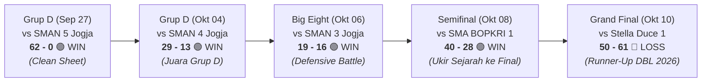

# Analisis Statistik Tim Basket Putri SMA Budi Utama
**Kompetisi:** Honda DBL with Kopi Good Day D.I. Jogjakarta Series (Women/Putri)  
**ID Kompetisi Sumber:** `49609`  
**ID Tim Sumber:** `146119`  
**Status / Capaian:** Juara Grup D (2-0) & **RUNNER-UP DBL D.I. JOGJAKARTA SERIES 2026**  
**Rekor Keseluruhan:** 4 Menang – 1 Kalah (4-1)  
**Pertahanan Turnamen:** Kemasukan hanya **23.6 Poin per Game** & Memaksa Lawan **51.7% Turnover Rate**

---

## 1. Ringkasan Rekor & Hasil Pertandingan

### Rincian Laga per Laga

| No | Tanggal | Babak / Fase | Lawan | Skor | Status | eFG% (BU vs Lawan) | Highlight & Catatan Utama |
| :---: | :---: | :--- | :--- | :---: | :---: | :---: | :--- |
| **1** | 27 Sep 2026 | Penyisihan Grup D | SMAN 5 Yogyakarta | **62 – 0** | **WIN** | 43.8% vs 0.0% | **Rekor Bersejarah: Clean sheet** (0 poin kebobolan), 33 steal, 46 TO lawan. |
| **2** | 04 Okt 2026 | Penyisihan Grup D | SMAN 4 Yogyakarta | **29 – 13** | **WIN** | 37.5% vs 17.7% | Mengunci Juara Grup D; lawan ditahan pada FG 17.7% dan 29 TO. |
| **3** | 06 Okt 2026 | Perempat Final (*Big Eight*) | SMAN 3 Yogyakarta | **19 – 16** | **WIN** | 15.6% vs 35.0% | Pertarungan defensif ketat; mencuri 22 steal dan memicu 40 TO lawan. |
| **4** | 08 Okt 2026 | Semifinal (*Fantastic Four*) | SMA BOPKRI 1 Yogyakarta | **40 – 28** | **WIN** | 28.6% vs 15.8% | Menundukkan unggulan BOSA; tiket Final pertama dalam sejarah sekolah. |
| **5** | 10 Okt 2026 | Grand Final | SMA Stella Duce 1 (STECE) | **50 – 61** | **LOSS** | 40.7% vs 33.7% | Laga final tempo tinggi; cetak 50 poin namun kalah turnover (58 TO) & rebound. |

---

## 2. Analisis Four Factors (Dean Oliver)

Metrik Four Factors membedah efisiensi per *possession* tim dengan 4 indikator utama penentu kemenangan:

### A. Four Factors Akumulasi 1 Turnamen Penuh (5 Pertandingan)

| Four Factors (Bobot) | Nilai Budi Utama | Peringkat DBL (18 Tim) | Nilai Lawan (Defense) | Analisis Efisiensi Per Possession |
| :--- | :---: | :---: | :---: | :--- |
| **1. Shooting (eFG%) – Bobot 40%** | **33.40%** | **#4** | **23.35%** | **Pertahanan Menembak Elit**: Menekan efektivitas tembakan seluruh lawan hingga hanya 23.35%. |
| **2. Turnovers (TOV%) – Bobot 25%** | **39.47%** | **#5** | **51.68% (#8)** | **Kekuatan terbesar tim**: Memaksa turnover lawan 51.68% melalui skema *full-court press*. |
| **3. Rebounding (ORB/DRB) – Bobot 20%** | **39.07% (ORB)**| **#5 (DRB)** | **59.12% (DRB)** | Mengamankan 59.12% rebound defensif (Rank #5 DRB%) dan merebut 39.07% offensive rebound. |
| **4. Free Throw Rate (FTR) – Bobot 15%** | **34.41%** | **#6** | **35.85%** | Rasio lemparan bebas moderat; menghasilkan 85 FTA dari 247 FGA (17.0 FTA/game). |

---

### B. Matriks Four Factors Laga per Laga (*Game-by-Game Breakdown*)

| Pertandingan | eFG% (BU vs Lawan) | TOV% (BU vs Lawan) | ORB% (BU) | DRB% (BU) | FT Rate (BU vs Lawan) | Net Game Rating |
| :--- | :---: | :---: | :---: | :---: | :---: | :---: |
| **vs SMAN 5 Yogyakarta (62–0)** | **43.75%** vs 0.00% | **25.96%** vs 74.87% | **70.00%** | 66.67% | 9.38% vs 4.76% | **+35.80** (Dominasi Mutlak) |
| **vs SMAN 4 Yogyakarta (29–13)** | **37.50%** vs 17.74% | **33.86%** vs 54.43% | **25.00%** | 50.00% | 38.89% vs 38.71% | **+14.25** (Defense Solid) |
| **vs SMAN 3 Yogyakarta (19–16)** | **15.63%** vs 35.00% | **33.49%** vs 67.20% | **42.42%** | 60.00% | 27.08% vs 40.00% | **+8.10** (Clutch Battle) |
| **vs SMA BOPKRI 1 (40–28)** | **28.57%** vs 15.79% | **38.79%** vs 39.96% | **30.30%** | 66.00% | 37.50% vs 56.14% | **+12.40** (Semifinal Upset) |
| **vs SMA Stella Duce 1 (50–61)** | **40.70%** vs 33.73% | **53.88%** vs 38.49% | **25.93%** | 54.39% | 72.09% vs 27.71% | **-5.42** (Final Battle) |

---

## 3. Statistik Lengkap Individu Pemain (Rata-rata per Game & Jumlah Total)

> **Panduan Membaca Kolom:**
> Baris atas adalah **Rata-rata per Pertandingan (Per Game)**, baris bawah *(...)* adalah **Jumlah Total Turnamen**.
> * **MIN**: Menit/Game *(Total Menit)*
> * **PPG / RPG / APG / SPG / BPG / TOPG**: Rata-rata per Laga *(Total)*
> * **FG% / 2P% / 3P% / FT%**: Akurasi *(Made/Attempt)*
> * **EFF/G**: Efisiensi FIBA per Laga *(Total Rating)*

| No | Nama Pemain | Pos | GP | MIN | PPG | FG% | 2P% | 3P% | FT% | RPG | OREB | DREB | APG | SPG | BPG | TOPG | EFF/G |
| :---: | :--- | :---: | :---: | :---: | :---: | :---: | :---: | :---: | :---: | :---: | :---: | :---: | :---: | :---: | :---: | :---: | :---: |
| **1** | **Zahira Adiya Mecca** | #16 | 5 | 22.9 *(114:26)* | **10.6** *(53)* | 34.6% *(18/52)* | **39.0%** *(16/41)* | 18.2% *(2/11)* | 48.4% *(15/31)* | **6.2** *(31)* | 2.6 *(13)* | **3.6** *(18)* | 0.8 *(4)* | **4.2** *(21)* | 0.8 *(4)* | 3.6 *(18)* | **+9.0** *(+45)* |
| **2** | **Naysia Agustina Santosa** | #4 | 5 | 22.7 *(113:30)* | **7.2** *(36)* | 33.3% *(13/39)* | 36.0% *(9/25)* | **28.6%** *(4/14)* | 46.2% *(6/13)* | 1.8 *(9)* | 0.8 *(4)* | 1.0 *(5)* | **1.8** *(9)* | **4.0** *(20)* | **1.2** *(6)* | 4.6 *(23)* | **+4.8** *(+24)* |
| **3** | **Queenara Alfarzana Pratiwi** | #42 | 5 | 17.5 *(87:31)* | **5.0** *(25)* | **50.0%** *(12/24)* | **50.0%** *(12/24)* | - *(0/0)* | 20.0% *(1/5)* | **4.0** *(20)* | 1.0 *(5)* | **3.0** *(15)* | 1.4 *(7)* | **2.6** *(13)* | 0.0 *(0)* | 3.8 *(19)* | **+6.0** *(+30)* |
| **4** | **Gracielle Alayna Ong** | #7 | 5 | 19.2 *(96:04)* | 4.2 *(21)* | 28.6% *(10/35)* | 34.5% *(10/29)* | 0.0% *(0/6)* | 9.1% *(1/11)* | 2.8 *(14)* | 1.4 *(7)* | 1.4 *(7)* | 0.6 *(3)* | 2.2 *(11)* | 0.2 *(1)* | 4.4 *(22)* | -1.4 *(-7)* |
| **5** | **Difa Amelia Dianur** | #12 | 5 | 19.7 *(98:19)* | 3.8 *(19)* | 27.6% *(8/29)* | 33.3% *(6/18)* | 18.2% *(2/11)* | 25.0% *(1/4)* | 2.4 *(12)* | 0.8 *(4)* | 1.6 *(8)* | **1.6** *(8)* | **3.2** *(16)* | 0.2 *(1)* | 3.8 *(19)* | +2.6 *(+13)* |
| **6** | Nicolle Jacqueline I. S. | #0 | 4 | 17.7 *(70:52)* | 3.5 *(14)* | 30.8% *(4/13)* | 27.3% *(3/11)* | **50.0%** *(1/2)* | 50.0% *(5/10)* | 1.8 *(7)* | 0.3 *(1)* | 1.5 *(6)* | 1.0 *(4)* | 1.0 *(4)* | 0.0 *(0)* | 2.3 *(9)* | +1.5 *(+6)* |
| **7** | **Hanani Sanjaya** | #28 | 5 | 17.6 *(88:14)* | 2.0 *(10)* | 30.8% *(4/13)* | 33.3% *(4/12)* | 0.0% *(0/1)* | 50.0% *(2/4)* | **3.8** *(19)* | 1.4 *(7)* | 2.4 *(12)* | 1.2 *(6)* | **3.0** *(15)* | 0.0 *(0)* | **1.0** *(5)* | **+6.8** *(+34)* |
| **8** | Feodora Poetri Permana | #21 | 5 | 7.6 *(38:09)* | 1.4 *(7)* | **50.0%** *(3/6)* | **50.0%** *(3/6)* | - *(0/0)* | **100%** *(1/1)* | 2.8 *(14)* | 1.2 *(6)* | 1.6 *(8)* | 0.4 *(2)* | 1.2 *(6)* | 0.0 *(0)* | **1.0** *(5)* | +4.2 *(+21)* |
| **9** | Gabrielle Seanna | #11 | 5 | 6.5 *(32:20)* | 1.2 *(6)* | 37.5% *(3/8)* | **60.0%** *(3/5)* | 0.0% *(0/3)* | - *(0/0)* | 1.0 *(5)* | 0.6 *(3)* | 0.4 *(2)* | 0.4 *(2)* | 0.6 *(3)* | 0.0 *(0)* | 0.6 *(3)* | +1.6 *(+8)* |
| **10** | Benedicta Elvina M. | #13 | 5 | 5.8 *(28:55)* | 0.8 *(4)* | 11.1% *(2/18)* | 13.3% *(2/15)* | 0.0% *(0/3)* | - *(0/0)* | 1.0 *(5)* | 0.6 *(3)* | 0.4 *(2)* | 0.0 *(0)* | 1.4 *(7)* | 0.0 *(0)* | 0.8 *(4)* | -0.8 *(-4)* |
| **11** | Catherine Olivia Handoyo | #9 | 5 | 3.3 *(16:32)* | 0.6 *(3)* | 14.3% *(1/7)* | 14.3% *(1/7)* | - *(0/0)* | 25.0% *(1/4)* | 1.6 *(8)* | 0.6 *(3)* | 1.0 *(5)* | 0.4 *(2)* | 0.8 *(4)* | 0.0 *(0)* | 0.8 *(4)* | +0.8 *(+4)* |
| **12** | Maycha Kayla Nindiyani | #17 | 5 | 7.0 *(35:08)* | 0.4 *(2)* | 0.0% *(0/3)* | 0.0% *(0/3)* | - *(0/0)* | **100%** *(2/2)* | 1.8 *(9)* | 0.6 *(3)* | 1.2 *(6)* | 0.0 *(0)* | 0.2 *(1)* | **1.0** *(5)* | 1.2 *(6)* | +1.6 *(+8)* |
| **TOTAL** | **TOTAL TIM (SMA BUDI UTAMA)** | — | **5** | **164.0** *(820:00)* | **40.0** *(200)* | **31.6%** *(78/247)* | **35.2%** *(69/196)* | **17.6%** *(9/51)* | **41.2%** *(35/85)* | **36.0** *(180)* | **11.8** *(59)* | **18.8** *(94)* | **9.4** *(47)* | **24.2** *(121)* | **3.4** *(17)* | **29.4** *(147)* | **+36.4** *(+182)* |
---

## 4. Profil & Peran Pemain Kunci

### 1. #16 Zahira Adiya Mecca — *Primary Scoring Option & Rebounder*
* **10.6 PPG** | 6.2 RPG | 4.2 SPG
* 39.0% 2P | 48.4% FT (31 FTA)
* Efisiensi: **9.0 / game** (+45 Total)

### 2. #4 Naysia Agustina Santosa — *Perimeter Threat & Defensive Anchor*
* **7.2 PPG** | 4.0 SPG | 1.8 APG
* 28.6% 3P (4 Tripoin) | 1.2 BPG (6 BLK)
* 19 Pts di Grand Final vs STECE

### 3. #42 Queenara Alfarzana Pratiwi — *High Efficiency Interior Finisher*
* **5.0 PPG** | 4.0 RPG | 2.6 SPG
* **50.0% FG** (12/24) | 0 TO di Final
* Efisiensi: **6.0 / game** (+30 Total)

### 4. #28 Hanani Sanjaya — *Ball Security & Defensive Anchor*
* **3.8 RPG** | 3.0 SPG | 2.0 PPG
* **Hanya 5 TO di 5 Laga** (1.0 TOPG)
* Efisiensi: **6.8 / game** (+34 Total)

---

## 5. Evaluasi Taktis & Rekomendasi Masa Depan

### ✅ Keunggulan Kompetitif (Strengths)
* **Pertahanan Trap & Steals Elit:** Menghasilkan 24.2 steals dan memicu 38.2 turnover lawan per laga (+12.21% turnover margin).
* **Pertahanan Perimeter Luar Biasa:** Mampu menekan akurasi efektif seluruh lawan hingga hanya 23.35% eFG turnamen.
* **Kedalaman Rotasi 12 Pemain:** Seluruh pemain bermain aktif dan menjaga intensitas fisik tetap tinggi hingga kuarter 4.

### ⚠️ Ruang Pembenahan (Areas for Improvement)
* **Manajemen Turnover Sendiri (29.4 TOPG):** Tempo super cepat memicu banyak kesalahan sendiri (tertinggi 58 TO di Final).
* **Akurasi Lemparan Bebas (41.2%):** Hanya memasukkan 35 dari 85 FT; kehilangan 50 potensi poin dari garis foul.
* **Akurasi Tripoin (17.6%):** Hanya 9/51 3PT. Perlu tambahan penembak luar agar ruang penetrasi Zahira & Queenara lebih terbuka.
