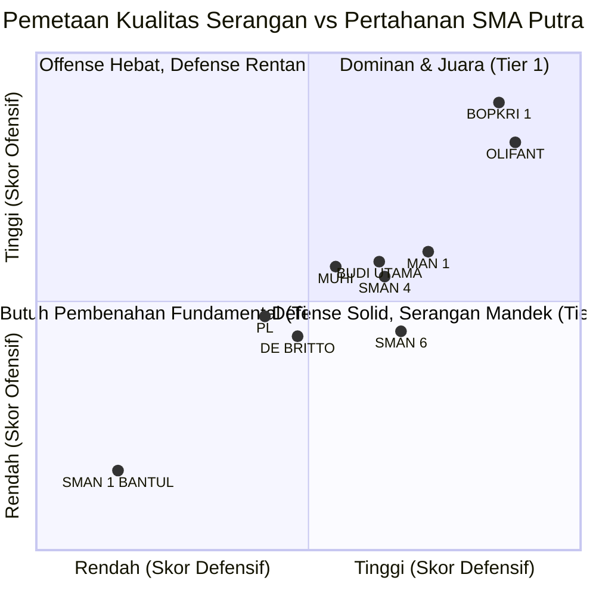

# Analisis Four Factors Seluruh Tim SMA Putra
## DBL DI Jogjakarta Series 2026 (Kompetisi 49607)

Dokumen ini memuat hasil perhitungan metrik analitik **Four Factors (Dean Oliver)** untuk seluruh **27 tim SMA Putra** yang berpartisipasi pada Honda DBL with Kopi Good Day D.I. Jogjakarta Series 2026.

---

## 1. Metodologi & Bobot Analitik (Dean Oliver)

Four Factors adalah empat indikator fundamental penentu kemenangan dalam analitik bola basket modern dengan bobot pengaruh:

| Faktor | Bobot | Rumus Ofensif (Menyerang) | Rumus Defensif (Bertahan) |
| :--- | :---: | :--- | :--- |
| **1. Shooting (eFG%)** | **40%** | $\frac{\text{FGM} + 0.5 \times \text{3PM}}{\text{FGA}}$ | $100\% - \text{Opponent eFG\%}$ |
| **2. Turnovers (TOV%)** | **25%** | $100\% - \frac{\text{TOV}}{\text{FGA} + 0.44 \times \text{FTA} + \text{TOV}}$ | $\text{Opponent TOV\%}$ |
| **3. Rebounding (ORB%)** | **20%** | $\frac{\text{OREB}}{\text{OREB} + \text{Opp DREB}}$ | $\text{DRB\%} = \frac{\text{DREB}}{\text{DREB} + \text{Opp OREB}}$ |
| **4. Free Throw Rate (FTR)** | **15%** | $\frac{\text{FTA}}{\text{FGA}}$ | $100\% - \frac{\text{Opp FTA}}{\text{Opp FGA}}$ |

* **Skor Ofensif (0–100)**: $0.40(\text{eFG\%}) + 0.25(1 - \text{TOV\%}) + 0.20(\text{ORB\%}) + 0.15(\text{FTR})$
* **Skor Defensif (0–100)**: $0.40(1 - \text{Opp eFG\%}) + 0.25(\text{Opp TOV\%}) + 0.20(\text{DRB\%}) + 0.15(1 - \text{Opp FTR})$
* **Overall Rating**: $(\text{Skor Ofensif} + \text{Skor Defensif}) / 2$
* **Net Margin**: Keunggulan bersih per possession terhadap lawan.

---

## 2. Klasemen Four Factors Seluruh 27 Tim Putra

*Diurutkan berdasarkan **Net Margin Rating** (Kualitas Dominasi vs Lawan).*

| Rank | Tim Putra | GP | Rekor | 1. eFG% | 2. TOV% | 3. ORB% | 4. FTR | Opp eFG% | Opp TOV% | DRB% | Opp FTR | Off Rtg | Def Rtg | Overall | Net Margin |
| :---: | :--- | :---: | :---: | :---: | :---: | :---: | :---: | :---: | :---: | :---: | :---: | :---: | :---: | :---: | :---: |
| 🥇 1 | **SMA BOPKRI 1 YOGYAKARTA** | 4 | 4–0 | **53.62%** | **15.30%** | **53.85%** | 18.84% | 23.98% | 39.75% | **81.89%** | 20.47% | **56.22** | 68.66 | **62.44** | **+24.87** |
| 🥈 2 | **SMA OLIFANT** | 4 | 4–0 | 42.51% | **13.73%** | **58.14%** | 31.36% | 20.39% | **44.62%** | **75.93%** | 26.97% | 54.90 | **69.14** | **62.02** | **+24.04** |
| 🥉 3 | **MAN 1 YOGYAKARTA** | 2 | 1–1 | 35.50% | 20.39% | 48.48% | 30.00% | 24.58% | 42.32% | **77.78%** | 45.76% | 48.30 | 64.44 | **56.37** | **+12.74** |
| 4 | **SMA BUDI UTAMA** | 4 | 3–1 | 38.20% | 16.43% | 43.14% | 22.40% | 29.55% | 42.60% | 61.90% | 29.22% | 48.16 | 61.83 | **54.99** | **+9.99** |
| 5 | **SMA NEGERI 4 YOGYAKARTA** | 4 | 3–1 | 36.41% | 24.14% | 47.73% | 29.49% | **19.75%** | 37.72% | 61.02% | 45.22% | 47.50 | 61.95 | **54.72** | **+9.45** |
| 6 | **SMA MUHAMMADIYAH 1 YK** | 4 | 3–1 | 43.17% | 22.34% | 38.64% | 23.35% | 32.61% | 27.92% | 66.42% | 19.32% | 47.91 | 59.32 | **53.62** | **+7.24** |
| 7 | **SMAN 6 YOGYAKARTA** | 2 | 1–1 | 28.99% | 31.95% | 39.58% | 46.38% | 21.21% | 37.90% | 63.27% | 37.88% | 43.48 | 62.96 | **53.22** | **+6.44** |
| 8 | **SMAN 1 YOGYAKARTA** | 2 | 1–1 | 38.89% | 32.19% | 36.36% | 20.99% | 20.00% | 30.53% | 59.65% | 28.24% | 42.93 | 62.33 | **52.63** | **+5.26** |
| 9 | **SMAN 1 SEWON** | 2 | 1–1 | 32.08% | 22.85% | 42.65% | 18.87% | 35.71% | 42.43% | 58.97% | 41.43% | 43.48 | 56.90 | **50.19** | **+0.38** |
| 10 | **SMAN 5 YOGYAKARTA** | 2 | 1–1 | 24.03% | 29.40% | 46.55% | 20.78% | 25.76% | 31.75% | 61.22% | 31.82% | 39.69 | 60.11 | **49.90** | **-0.21** |
| 11 | **SMA KOLESE DE BRITTO** | 3 | 2–1 | 20.53% | 21.07% | 46.79% | 37.75% | 37.04% | 44.97% | 67.27% | 54.32% | 42.96 | 56.73 | **49.85** | **-0.30** |
| 12 | **SMA PANGUDI LUHUR YOGYA** | 3 | 2–1 | 37.65% | 42.88% | 33.33% | **57.65%** | 34.09% | 24.22% | 52.00% | 22.08% | 44.65 | 54.51 | **49.58** | **-0.84** |
| 13 | **SMA NEGERI 11 YOGYAKARTA**| 2 | 0–2 | 29.69% | 38.61% | 43.14% | 43.75% | 30.88% | 34.50% | 56.60% | 45.59% | 42.41 | 55.75 | **49.08** | **-1.83** |
| 14 | **SMAN 9 YOGYAKARTA** | 2 | 0–2 | 22.08% | 34.40% | 40.68% | 25.97% | 25.56% | 25.77% | 60.00% | 20.00% | 37.26 | 60.22 | **48.74** | **-2.52** |
| 15 | **SMA NEGERI 3 YOGYAKARTA** | 2 | 0–2 | 25.00% | 40.12% | 37.78% | 53.45% | 28.09% | 21.36% | 58.46% | 35.96% | 40.54 | 55.40 | **47.97** | **-4.05** |
| 16 | **SMAN 1 KASIHAN BANTUL** | 2 | 1–1 | 29.90% | 27.92% | 46.38% | 26.80% | 41.27% | 38.41% | 61.90% | 61.90% | 43.28 | 51.19 | **47.23** | **-5.53** |
| 17 | **SMAN 8 YOGYAKARTA** | 3 | 2–1 | 26.86% | 28.43% | 31.76% | 28.10% | 32.97% | 23.17% | 52.69% | 34.78% | 39.20 | 52.93 | **46.07** | **-7.87** |
| 18 | **SMA BUDI MULIA DUA** | 3 | 2–1 | 25.65% | 34.99% | 34.15% | 26.09% | 35.63% | 22.01% | 48.54% | 19.38% | 37.26 | 53.05 | **45.16** | **-9.69** |
| 19 | **SMA STELLA DUCE 2** | 2 | 1–1 | 26.43% | 37.99% | 36.73% | 27.14% | 40.32% | 20.14% | 50.00% | 34.41% | 37.49 | 48.74 | **43.12** | **-13.76** |
| 20 | **SMAN 2 BANTUL** | 2 | 0–2 | 14.71% | 39.69% | 27.27% | 36.76% | 35.58% | 20.58% | 54.84% | 17.31% | 31.93 | 54.29 | **43.11** | **-13.79** |
| 21 | **SMAN 1 KALASAN** | 2 | 0–2 | 17.27% | 49.97% | 33.33% | **58.18%** | 49.55% | 20.04% | 55.77% | 11.82% | 34.81 | 49.57 | **42.19** | **-15.62** |
| 22 | **SMAN 2 YOGYAKARTA** | 2 | 1–1 | 22.37% | 32.59% | 31.58% | 26.32% | 41.67% | 23.81% | 33.87% | 29.41% | 36.06 | 46.65 | **41.36** | **-17.29** |
| 23 | **SMAN 2 NGAGLIK** | 2 | 0–2 | 20.37% | 53.62% | 23.68% | 12.96% | 28.15% | 15.28% | 50.65% | 26.89% | 26.42 | 53.66 | **40.04** | **-19.92** |
| 24 | **SMAN 10 YOGYAKARTA** | 2 | 0–2 | 23.85% | 48.49% | 33.33% | 21.54% | 46.19% | 14.61% | 52.17% | 20.34% | 32.31 | 47.56 | **39.94** | **-20.13** |
| 25 | **SMAN 7 YOGYAKARTA** | 2 | 1–1 | 18.38% | 41.18% | 21.57% | 16.18% | 42.79% | 19.28% | 50.00% | 28.85% | 28.80 | 48.38 | **38.59** | **-22.82** |
| 26 | **SMAN 1 BANGUNTAPAN** | 2 | 0–2 | 16.98% | 55.42% | 25.58% | 24.53% | 44.34% | 23.73% | 48.33% | 20.75% | 26.73 | 49.75 | **38.24** | **-23.52** |
| 27 | **SMAN 1 BANTUL** | 2 | 0–2 | 18.63% | **55.56%** | 28.95% | 29.41% | 48.86% | 9.49% | 41.18% | 18.94% | 28.76 | 43.22 | **35.99** | **-28.01** |

---

## 3. Pemetaan & Segmentasi Kategori Tim (Tier Analysis)

### 🏆 Tier 1: Dominan & Calon Juara (Net Margin > +20.0)
* **SMA BOPKRI 1 Yogyakarta (+24.87)** & **SMA Olifant (+24.04)**
* Karakteristik: Akurasi tembakan jauh melampaui rata-rata kompetisi (eFG% > 42%), perlindungan bola sangat prima (TOV% < 16%), dan *rebound rate* luar biasa (ORB% > 53%, DRB% > 75%).

### ⚔️ Tier 2: Penantang Utama / Upper Tier (Net Margin +5.0 s.d. +15.0)
* **MAN 1 Yogyakarta (+12.74)**, **SMA Budi Utama (+9.99)**, **SMA Negeri 4 Yogyakarta (+9.45)**, **SMA Muhammadiyah 1 Yogyakarta (+7.24)**, **SMAN 6 (+6.44)**, **SMAN 1 Yogyakarta (+5.26)**.
* Karakteristik: Memiliki satu atau dua senjata utama (misal *full-court press* dan *steals* tinggi pada Budi Utama & SMAN 4), namun memiliki kelemahan di tembakan 3-poin atau rotasi size di bawah ring.

### 🛡️ Tier 3: Tim Kompetitif / Mid-Tier (Net Margin -5.0 s.d. +1.0)
* **SMAN 1 Sewon**, **SMAN 5 Yogyakarta**, **SMA Kolese De Britto**, **SMA Pangudi Luhur**, **SMAN 11 Yogyakarta**, **SMAN 9 Yogyakarta**, **SMAN 3 Yogyakarta**.
* Karakteristik: Pertahanan cukup disiplin, namun kesulitan menjaga efisiensi ofensif saat menghadapi tim dengan sistem transisi cepat.

### ⚠️ Tier 4: Tim Butuh Pembenahan Fundamental (Net Margin < -10.0)
* **SMAN 1 Bantul**, **SMAN 1 Banguntapan**, **SMAN 7**, **SMAN 10**, **SMAN 2 Ngaglik**, **SMAN 2 Kalasan**, **SMAN 2 Bantul**, dll.
* Karakteristik: Tingkat turnover sangat tinggi (TOV% > 40%), sering kehilangan possession sebelum sempat melepaskan tembakan (*ball-handling struggle*).

---

## 4. Leaderboard Spesifik Per Kategori

### A. 🎯 Tembakan Paling Efisien (Top 5 eFG%)
1. **SMA BOPKRI 1 YOGYAKARTA** – **53.62%**
2. **SMA MUHAMMADIYAH 1 YK** – **43.17%**
3. **SMA OLIFANT** – **42.51%**
4. **SMAN 1 YOGYAKARTA** – **38.89%**
5. **SMA BUDI UTAMA** – **38.20%**

### B. 🛡️ Pertahanan Paling Mematikan (Top 5 Opponent eFG% Terendah)
1. **SMA NEGERI 4 YOGYAKARTA** – **19.75%** *(Lawan hanya mampu 19.7% eFG)*
2. **SMAN 1 YOGYAKARTA** – **20.00%**
3. **SMA OLIFANT** – **20.39%**
4. **SMAN 6 YOGYAKARTA** – **21.21%**
5. **SMA BOPKRI 1 YOGYAKARTA** – **23.98%**

### C. 🔒 Keamanan Bola / Turnover Terendah (Top 5 Lowest TOV%)
1. **SMA OLIFANT** – **13.73%**
2. **SMA BOPKRI 1 YOGYAKARTA** – **15.30%**
3. **SMA BUDI UTAMA** – **16.43%**
4. **MAN 1 YOGYAKARTA** – **20.39%**
5. **SMA KOLESE DE BRITTO** – **21.07%**

### D. ⚡ Penghasil Turnover Lawan Tertinggi (Top 5 Opponent TOV%)
1. **SMA OLIFANT** – **44.62%** *(Memaksa lawan turnover pada 44.6% possession)*
2. **SMA KOLESE DE BRITTO** – **44.97%**
3. **SMA BUDI UTAMA** – **42.60%**
4. **SMAN 1 SEWON** – **42.43%**
5. **MAN 1 YOGYAKARTA** – **42.32%**

### E. 👑 Penguasa Rebound (Top 5 ORB% & DRB%)
* **Offensive Rebound Rate (ORB%)**:
  1. SMA OLIFANT – **58.14%**
  2. SMA BOPKRI 1 YOGYAKARTA – **53.85%**
  3. MAN 1 YOGYAKARTA – **48.48%**
  4. SMA NEGERI 4 YOGYAKARTA – **47.73%**
  5. SMA KOLESE DE BRITTO – **46.79%**
* **Defensive Rebound Rate (DRB%)**:
  1. SMA BOPKRI 1 YOGYAKARTA – **81.89%**
  2. MAN 1 YOGYAKARTA – **77.78%**
  3. SMA OLIFANT – **75.93%**
  4. SMA KOLESE DE BRITTO – **67.27%**
  5. SMA MUHAMMADIYAH 1 YK – **66.42%**
