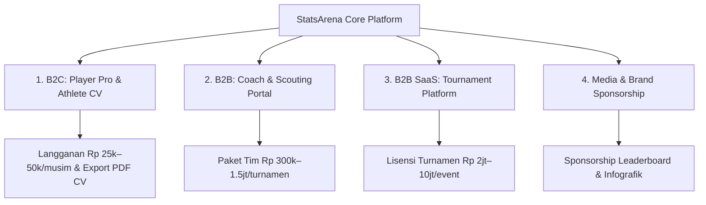

# Strategi Monetisasi StatsArena

Dokumen ini menjabarkan peta strategi monetisasi, model bisnis, segmen pasar, dan rencana eksekusi untuk mengembangkan platform analitik olahraga **StatsArena** menjadi produk komersial yang berkelanjutan (*sustainable revenue stream*).

---

## 1. Ringkasan Eksekutif & Value Proposition

StatsArena memiliki fondasi data yang kuat: data pertandingan tervalidasi, shot chart, play-by-play, dan metrik efisiensi modern (eFG%, TS%, Per-Game Averages). 

**Peluang Pasar Utama:**
1. **Pemain & Orang Tua (B2C):** Kebutuhan akan portofolio statistik terverifikasi untuk pendaftaran jalur prestasi/beasiswa kuliah (SNBP/Prestasi) atau seleksi klub profesional.
2. **Pelatih & Sekolah (B2B):** Kebutuhan akan laporan taktik (*scouting report*) dan evaluasi performa tanpa harus menghitung data mentah secara manual.
3. **Penyelenggara Turnamen (B2B SaaS):** Kebutuhan platform statistik live siap pakai untuk turnamen komunitas/kampus/daerah.
4. **Brand & Sponsor (Advertising/Partnership):** Audiens yang sangat spesifik dan loyal (komunitas basket, atlet muda, audiens usia 15–35 tahun).

---

## 2. 4 Pilar Model Bisnis (*Revenue Streams*)

---

### Stream 1: B2C — "Player Pro & Athlete Portfolio" (Pemain & Orang Tua)

Menargetkan pemain basket SMA (DBL), liga mahasiswa (LIMA/turnamen kampus), dan klub junior.

#### Fitur Gratis (*Freemium*):
- Melihat skor akhir, jadwal, dan box score standar pertandingan.
- Profil pemain dasar (total poin, rebound, assist).

#### Fitur Berbayar (*StatsArena Player Pro*):
- **Digital Athlete Card (ala FIFA / NBA 2K):**
  - Radar chart atribut performa (*Shooting, Playmaking, Rebounding, Defense, Efficiency*).
  - *Shot Chart Heatmap* personal dari seluruh pertandingan yang pernah dimainkan.
  - *Percentile Ranking* (contoh: *"Top 5% 3PT Shooter di DBL Jogja"*).
- **Official Athlete CV / Portfolio (Export PDF 1-Klik):**
  - Dokumen resmi siap cetak berisi rekap statistik komprehensif untuk lampiran beasiswa kuliah, seleksi tim daerah (PON/Popda), atau portofolio atlet.
- **Head-to-Head Comparison:**
  - Fitur perbandingan performa langsung antara pemain dengan rival di posisi yang sama.

**Model Harga:**
- Rp 25.000 – Rp 50.000 / musim / pemain
- Rp 15.000 untuk 1x ekspor PDF Athlete Portfolio resmi.

---

### Stream 2: B2B — "Coach & Team Scouting Portal" (Pelatih, Sekolah, & Klub)

Menargetkan pelatih kepala (*head coach*), asisten pelatih, dan manajemen tim sekolah/klub basket.

#### Fitur Utama:
- **Opponent Scouting Report (Analisis Kelemahan Lawan):**
  - Distribusi tembakan lawan (*tendency* tembakan kiri vs kanan, dominasi *paint area*).
  - Tren turnover lawan dan pola serangan.
- **Lineup & Rotation Efficiency:**
  - Efisiensi skor saat starter bermain vs pemain cadangan (*Bench Points & On/Off Stats*).
- **One-Click Post-Game Evaluation (Laporan PDF Pasca-Tanding):**
  - Laporan evaluasi instan setelah pertandingan selesai untuk bahan *briefing* dan evaluasi tim pelatih.

**Model Harga:**
- **Paket Turnamen:** Rp 300.000 – Rp 500.000 / tim / turnamen.
- **Paket Tahunan (Multi-Turnamen):** Rp 1.500.000 – Rp 3.000.000 / sekolah / tahun.

---

### Stream 3: B2B SaaS — "Turnamen Statistik as a Service" (Event Organizer)

Banyak turnamen basket/olahraga lokal (Piala Walikota, Liga Kampus, Kejurda, Turnamen Komunitas) yang ingin memiliki website jadwal & statistik secanggih DBL/IBL, tetapi tidak memiliki infrastruktur IT sendiri.

#### Layanan yang Disediakan:
- Dashboard turnamen *white-label* (menggunakan logo dan nama turnamen mereka).
- Input data statistik pertandingan (via form input web atau integrasi live).
- Leaderboard top skor, klasemen pool otomatis, dan visualisasi shot chart.

**Model Harga:**
- **Tier Komunitas (8–16 tim):** Rp 2.000.000 – Rp 4.000.000 / event.
- **Tier Turnamen Besar (> 16 tim):** Rp 5.000.000 – Rp 10.000.000 / event.

---

### Stream 4: Media, Sponsorship, & Brand Partnership

Platform data olahraga memiliki *screen time* dan *engagement* yang sangat tinggi dari kalangan anak muda (Gen Z & Millennials).

#### Peluang Iklan & Kemitraan:
- **"Sponsored Leaderboard / Player of the Week":**
  - Penempatan logo brand (sepatu basket, apparel lokal, minuman isotonik, gym/fitness center) pada header leaderboard.
- **Shareable Social Media Infographics:**
  - Fitur otomatis untuk men-generate gambar grafik statistik (Story/Post Instagram) dengan *watermark* / logo brand partner.

---

## 3. Rencana Eksekusi Bertahap (*Go-to-Market Roadmap*)

| Fase | Fokus Utama | Target Aksi & Monetisasi |
| :--- | :--- | :--- |
| **Fase 1: User Growth & Virality (Bulan 1–2)** | Membangun audiens & reputasi | • Rilis dashboard publik secara gratis. • Buat tombol *"Share my Player Card to Instagram Story"*. • Bangun awareness di komunitas basket SMA/kampus. |
| **Fase 2: B2C Monetization (Bulan 3–4)** | Monetisasi pemain & orang tua | • Luncurkan fitur **Athlete CV (Export PDF)** berbayar mikro. • Tawarkan paket *Player Pro* menjelang musim kelulusan SMA/pendaftaran kampus. |
| **Fase 3: B2B School Partnerships (Bulan 5–6)** | Pendapatan stabil dari tim | • Kunjungi 10–20 sekolah unggulan basket di Yogyakarta/wilayah target. • Berikan *free trial* Scouting Report untuk 1 pertandingan, lalu tawarkan paket turnamen. |
| **Fase 4: Multi-Tournament SaaS (Bulan 7+)** | Skalabilitas & Ekspansi | • Tawarkan platform ke EO turnamen basket dan cabang olahraga lain (sepak bola/futsal). • Buka kerja sama sponsorship dengan brand olahraga. |

---

## 4. Potensi Proyeksi Pendapatan (Studi Kasus 1 Wilayah / 1 Musim)

*Asumsi: 1 Series Turnamen (misal DBL Jogja = 27 Tim, 322 Pemain)*

| Jalur Pendapatan | Estimasi Konversi | Potensi Pendapatan (IDR) |
| :--- | :--- | :--- |
| **Player Pro & CV PDF** | 20% dari 322 pemain (64 pemain) @ Rp 35.000 | Rp 2.240.000 |
| **Paket Scouting Sekolah** | 6 tim unggulan @ Rp 500.000 | Rp 3.000.000 |
| **Platform Turnamen Lokal Tambahan** | 1 turnamen kampus/komunitas | Rp 3.500.000 |
| **Sponsorship Brand Lokal** | 1 brand apparel / gym | Rp 2.500.000 |
| **Total Estimasi per Musim/Kota** | — | **Rp 11.240.000 / kota** |

*(Pendapatan dapat berlipat ganda seiring penambahan kompetisi kota lain seperti Surabaya, Jakarta, Bandung, Solo, Semarang, dll.)*
